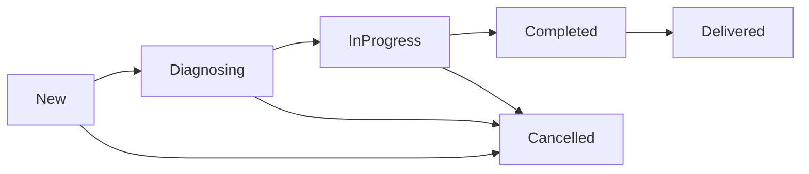
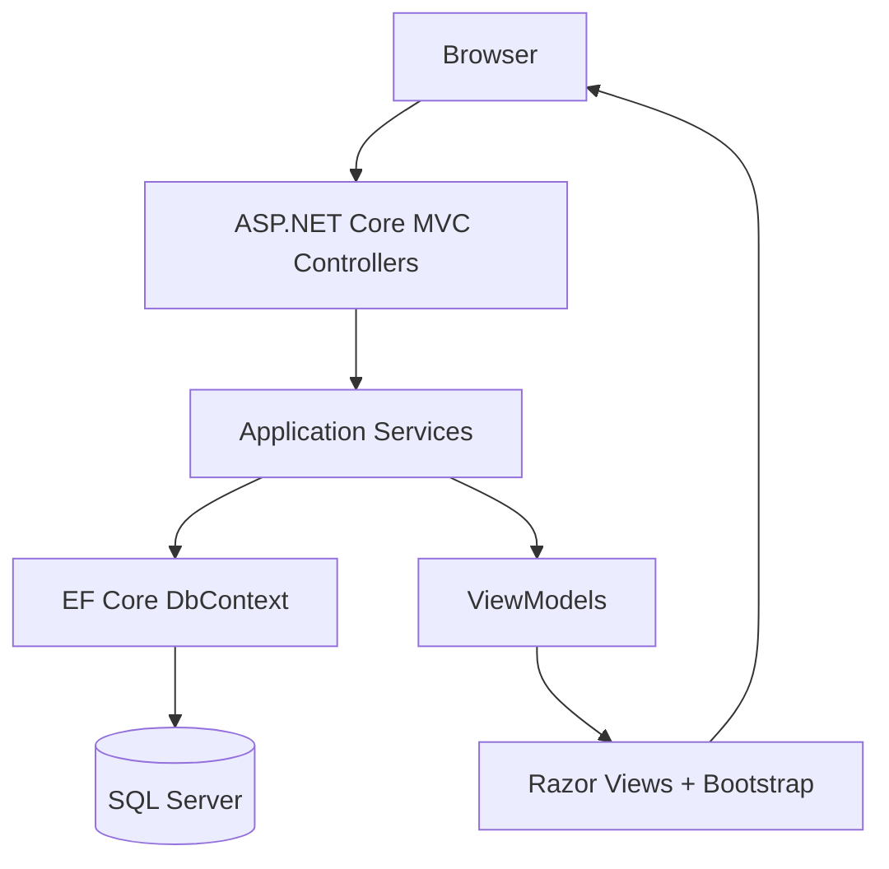
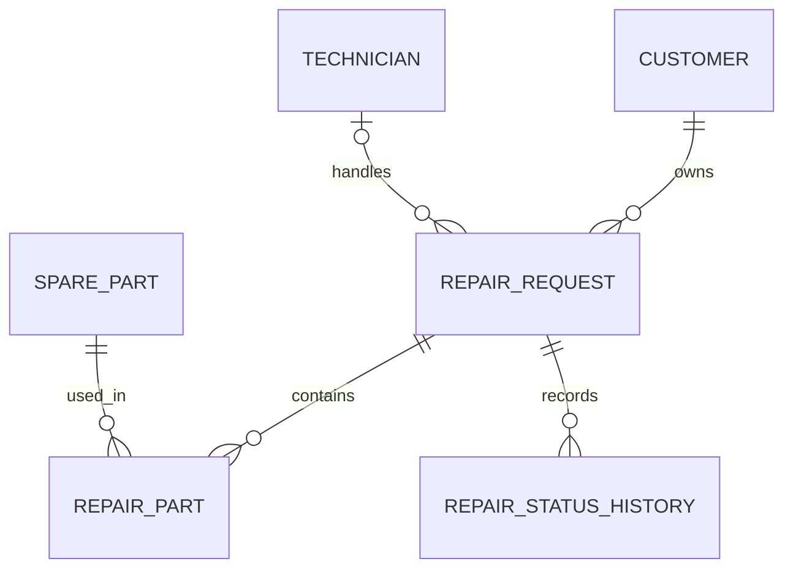

<div align="center">

# 🔧 FixFlow

### Repair shop management, from customer intake to device delivery

<p>
  
  
  
  
  
  
</p>

<p>
  <strong>4 management modules</strong> &nbsp;·&nbsp;
  <strong>6 database entities</strong> &nbsp;·&nbsp;
  <strong>Controlled repair workflow</strong> &nbsp;·&nbsp;
  <strong>Status history</strong>
</p>

[Explore the source code](https://github.com/stivanpashaliev/FixFlow)

</div>

---

> **TL;DR** — **FixFlow** is an ASP.NET Core MVC application for managing the day-to-day operations of an electronics repair shop. It brings **customers, technicians, spare parts, and repair requests** into one interface, tracks repairs through a controlled status workflow, records status changes, and calculates repair costs using historical spare-part prices. The application uses **Entity Framework Core with SQL Server**, Razor Views, Bootstrap, and server-side and client-side form validation.

---

## 📑 Table of Contents

- [Overview](#-overview)
- [Key Features](#-key-features)
- [Repair Workflow](#-repair-workflow)
- [Technology Stack](#-technology-stack)
- [Architecture](#-architecture)
- [Data Model](#-data-model)
- [Project Structure](#-project-structure)
- [Getting Started](#-getting-started)
- [Using the Application](#-using-the-application)
- [Validation & Business Rules](#-validation--business-rules)
- [Design Decisions](#-design-decisions)
- [Limitations & Future Work](#-limitations--future-work)
- [References](#-references)
- [Author](#-author)

---

## 🎯 Overview

A repair shop needs more than a list of broken devices. Each repair belongs to a customer, may be assigned to a technician, moves through several stages, and can involve both labor and replacement-part costs. Without a consistent process, it becomes difficult to understand **who is responsible, what has been done, and what the repair costs**.

**FixFlow** provides a simple, centralized workflow for those everyday tasks:

1. Register a customer and a device that needs repair.
2. Assign an available technician when appropriate.
3. Record the problem, diagnosis, and labor cost.
4. Move the repair through permitted status transitions.
5. Review its status history and calculated total cost.
6. Mark the device as delivered after the repair is completed.

The project was developed for the **SoftUni ASP.NET Fundamentals** course, with an emphasis on practical MVC architecture, relational data modeling, validation, and maintainable application logic.

---

## ✨ Key Features

| Module | Capabilities |
|---|---|
| **👤 Customers** | Create, list, view, edit, and delete customer records; validate contact details; prevent deletion when related repairs exist. |
| **🧑‍🔧 Technicians** | Full CRUD, specialization details, active/inactive status, and technician assignment rules. |
| **📦 Spare Parts** | Full CRUD, SKU tracking, unit prices, stock quantities, unique-SKU validation, and protection of parts referenced by repairs. |
| **🛠️ Repair Requests** | Register devices, associate customers and technicians, update diagnoses and labor costs, view repair details, and delete only eligible requests. |
| **🔄 Status Workflow** | Dedicated status-change screen with allowed transitions and checks for required technician, diagnosis, and cancellation note. |
| **🕘 Status History** | Chronological record of status changes, timestamps, and optional notes, displayed on the repair details page. |
| **💰 Repair Costs** | Calculate total cost from labor and the historical prices of parts associated with a repair. |

### Interface highlights

- Server-rendered **Razor Views** with a shared layout and reusable partial views.
- **Bootstrap 5** navigation, responsive tables, forms, and action buttons.
- Readable status badges for the different repair stages.
- **Data Annotations**, validation messages, and jQuery unobtrusive client-side validation.
- Confirmation pages and meaningful feedback for supported edit/delete operations.

---

## 🔄 Repair Workflow

Repairs follow a defined progression rather than allowing arbitrary status changes:



| Transition or operation | Rule |
|---|---|
| `New → Diagnosing` | The repair enters the diagnosis stage. |
| `Diagnosing → InProgress` | An assigned technician is required. |
| `InProgress → Completed` | A technician and a non-empty diagnosis are required; the completion timestamp is recorded in UTC. |
| `Completed → Delivered` | The existing completion timestamp is preserved. |
| `New / Diagnosing / InProgress → Cancelled` | A cancellation note is required; cancellation is blocked if the repair already has associated parts. |
| Edit a repair | Allowed in `New`, `Diagnosing`, and `InProgress`, subject to business rules. |
| Delete a repair | Allowed only when its status is `New` and no parts are associated with it. |

Every successful status change stores the **previous status, new status, timestamp, and optional note** in `RepairStatusHistory`. A newly created repair also receives an initial registration entry. Status updates use conditional database operations and a transaction to help prevent stale updates and keep the repair record consistent with its history.

---

## 🛠️ Technology Stack

| Layer | Technology |
|---|---|
| Language | **C#** |
| Runtime and web framework | **.NET 10**, **ASP.NET Core MVC** |
| Front end | **Razor Views**, HTML, CSS, **Bootstrap 5** |
| Validation | **Data Annotations**, **jQuery Validation**, **jQuery Unobtrusive Validation** |
| Data access | **Entity Framework Core 10.0.13** |
| Database | **Microsoft SQL Server / SQL Server Express** |
| Database provider | `Microsoft.EntityFrameworkCore.SqlServer` |
| Dependency injection | Built-in ASP.NET Core DI container |
| Development tools | **Visual Studio**, .NET CLI, **SQL Server Management Studio (SSMS)** |
| Version control | **Git** and **GitHub** |

The project also references `Microsoft.Data.SqlClient` for SQL Server-specific database error handling.

---

## 🧱 Architecture

FixFlow uses a conventional **ASP.NET Core MVC** structure. The controllers coordinate HTTP requests, services implement data-access and business operations, and view models define what each page needs to display or validate.



**Responsibilities**

- **Controllers** — handle requests, model validation, action results, and redirects.
- **Services and interfaces** — encapsulate queries, record updates, and repair-related business rules.
- **ViewModels** — separate form input and UI output from persistent entity models.
- **EF Core configurations** — define relationships, indexes, field lengths, precision, and delete behavior.
- **Razor partials** — reuse form markup, validation scripts, status badges, and the repair history display.

The project intentionally avoids unnecessary repository layers or additional frameworks: EF Core already provides a suitable data-access abstraction for this application.

---

## 🗄️ Data Model

The database contains six related entities:

| Entity | Purpose |
|---|---|
| `Customer` | Customer details and their repair requests. |
| `Technician` | Technician information, specialization, and active status. |
| `SparePart` | Part name, unique SKU, price, and current stock quantity. |
| `RepairRequest` | Device, issue, diagnosis, assigned people, repair status, labor cost, and timestamps. |
| `RepairPart` | Association between a repair and a part, including quantity and historical unit price. |
| `RepairStatusHistory` | Individual repair status transitions with timestamps and notes. |



### Repair cost calculation

```text
Total Cost = Labor Cost + Σ (Part Quantity × Unit Price at Use)
```

`UnitPriceAtUse` preserves the price at the time a part was associated with a repair. Changing the current `SparePart.UnitPrice` does **not** retrospectively change historical repair costs.

The EF Core model also defines a unique index on `SparePart.SKU`, a unique combination of `RepairRequestId` and `SparePartId`, and appropriate foreign-key delete restrictions.

---

## 📁 Project Structure

```text
FixFlow/
│
├── FixFlow.slnx                         # Solution file
├── FixFlow/
│   ├── Common/
│   │   ├── Constants/                  # Validation and database constants
│   │   └── Rules/                      # Repair status transition rules
│   │
│   ├── Controllers/                     # MVC request handling
│   │   ├── CustomersController.cs
│   │   ├── TechniciansController.cs
│   │   ├── SparePartsController.cs
│   │   └── RepairRequestsController.cs
│   │
│   ├── Data/
│   │   ├── Configurations/              # EF Core Fluent API mappings
│   │   ├── Seed/                        # Development sample data
│   │   └── FixFlowDbContext.cs
│   │
│   ├── Migrations/                      # Existing EF Core migration
│   ├── Models/
│   │   ├── Entities/                    # Six database entities
│   │   └── Enums/                       # Statuses and operation results
│   │
│   ├── Services/
│   │   ├── Interfaces/                  # Service contracts
│   │   └── Implementations/             # Business logic and EF queries
│   │
│   ├── ViewModels/                      # Forms, lists, details, status changes
│   ├── Views/                           # Razor pages, shared layout, partials
│   ├── wwwroot/                         # CSS and front-end libraries
│   ├── Properties/launchSettings.json   # HTTP/HTTPS development profiles
│   ├── appsettings.json                 # Default SQL Server connection
│   ├── Program.cs                       # Application startup and DI
│   └── FixFlow.csproj                   # Target framework and packages
│
├── .gitignore
└── README.md
```

---

## 🚀 Getting Started

The default configuration is designed for **local development on Windows with SQL Server Express**. A different SQL Server installation can also be used by overriding the connection string.

### 1. Prerequisites

- **.NET 10 SDK** — [Download](https://dotnet.microsoft.com/en-us/download/dotnet/10.0)
- **SQL Server Express** with an instance named `SQLEXPRESS` — [Download SQL Server](https://www.microsoft.com/en-us/sql-server/sql-server-downloads)
- **Git** — [Download](https://git-scm.com/downloads)
- **EF Core CLI tools** for the migration command below
- **Visual Studio** and **SSMS** are recommended but optional for command-line setup.

> The supplied `appsettings.json` uses **Windows integrated authentication**. The account running the application needs permission to connect to the SQL Server instance and create/use the `FixFlow` database.

### 2. Clone the repository

Open **PowerShell** or a terminal:

```powershell
git clone https://github.com/stivanpashaliev/FixFlow.git
cd FixFlow
```

### 3. Restore dependencies

```powershell
dotnet restore FixFlow.slnx
```

### 4. Configure SQL Server

The default connection string is located in `FixFlow/appsettings.json`:

```json
{
  "ConnectionStrings": {
    "DefaultConnection": "Server=.\\SQLEXPRESS;Database=FixFlow;Trusted_Connection=True;TrustServerCertificate=True;MultipleActiveResultSets=true"
  }
}
```

Start the SQL Server Express service and make sure the `SQLEXPRESS` instance is available.

If you use a different instance, you can override the connection string **without modifying tracked source files**. For example, in PowerShell, set the `ConnectionStrings__DefaultConnection` environment variable to your own SQL Server connection string before running the migration or application:

```powershell
$env:ConnectionStrings__DefaultConnection = 'Server=.\SQLEXPRESS;Database=FixFlow;Trusted_Connection=True;TrustServerCertificate=True;MultipleActiveResultSets=true'
```

Replace the server/instance portion when required by your local setup. For this local development configuration, **no SQL username or password is needed** because Windows authentication is enabled. Do not commit database passwords or other secrets to the repository.

> `TrustServerCertificate=True` is provided for local development convenience; it is not a recommended production TLS configuration.

### 5. Apply the existing migration

If `dotnet ef` is not installed, install the matching EF Core tool version:

```powershell
dotnet tool install --global dotnet-ef --version 10.0.13
```

Then create/update the database using the **migration already included in the repository**:

```powershell
dotnet ef database update --project FixFlow/FixFlow.csproj --startup-project FixFlow/FixFlow.csproj
```

> **Do not run `dotnet ef migrations add InitialCreate`.** The initial migration is already part of the project. `database update` applies it to your SQL Server instance.

### 6. Run the application

```powershell
dotnet run --project FixFlow/FixFlow.csproj --launch-profile https
```

Open **https://localhost:7079** in your browser. The project also defines an HTTP development address at **http://localhost:5185**.

If your browser reports that the development HTTPS certificate is not trusted, run:

```powershell
dotnet dev-certs https --trust
```

Alternatively, open `FixFlow.slnx` in Visual Studio, select the project's **https** launch profile, and start the application.

### 7. Explore the sample data

On startup in the **Development** environment, `DbSeeder` adds example records to empty tables:

| Sample entity | Initial records |
|---|---:|
| Customers | 3 |
| Technicians | 2 |
| Spare parts | 5 |
| Repair requests | 5 |
| Repair-part associations | 4 |
| Repair status history entries | 11 |

The sample repairs include a **Lenovo ThinkPad T480**, **Samsung Galaxy S22**, **Dell Inspiron 15**, **HP Pavilion 15**, and **iPhone 13**, covering different repair statuses.

The seeder checks for existing data and is not intended to overwrite records already present in the database. It runs **only in Development**; it does not automatically apply database migrations.

---

## 🖥️ Using the Application

The application opens on the **Repair Requests** page. The top navigation gives access to all four management modules.

### A typical repair scenario

1. Open **Customers** and register a customer.
2. Open **Technicians** and ensure an appropriate technician is active.
3. Open **Repair Requests** and create a new repair with a device name and problem description.
4. Open its details and use **Change Status** to start diagnosing the device.
5. Assign an active technician and move the repair to **InProgress**.
6. Enter a diagnosis and labor cost, then change the status to **Completed**.
7. Mark the repair as **Delivered** and review the status history and total cost.

The **Spare Parts** module manages the part catalog, prices, and stock quantities. Existing repair-part records contribute to cost calculations, but the current UI does **not** support adding/removing used parts from individual repairs or automatically deducting stock during a repair.

---

## 🛡️ Validation & Business Rules

FixFlow validates data at the form and application-service levels. Important rules include:

- Required fields and maximum string lengths for customer, technician, part, and repair information.
- Customer phone number formatting and optional email-address validation.
- Whitespace-aware customer name validation after trimming.
- Positive spare-part unit prices with at most **two decimal places** and non-negative stock quantities.
- Unique spare-part **SKU** values.
- Valid customer references and restrictions on assigning inactive technicians.
- An assigned technician is mandatory for an **InProgress** repair and for completing a repair.
- A non-empty diagnosis is required before completion.
- Protected status transitions and cancellation restrictions.
- Safe deletion behavior for customers, technicians, parts, and repairs with existing relationships.
- Anti-forgery validation on state-changing MVC POST actions.

Custom business validations are enforced **server-side** even when an equivalent JavaScript rule is not present on the client. The repair status flow also checks the expected prior status to reject stale submissions.

---

## 🧭 Design Decisions

<details>
<summary><strong>Why separate Entities from ViewModels?</strong></summary>

Database entities represent persistence and relationships. ViewModels expose only the information needed by a specific page or form, keeping form validation and UI concerns separate from the EF Core model.

</details>

<details>
<summary><strong>Why use Services instead of writing queries in Controllers?</strong></summary>

Services keep controllers focused on HTTP behavior while centralizing data access, business checks, and mapping. Interfaces are registered through the built-in dependency injection container, making responsibilities explicit without introducing an unnecessary generic repository layer.

</details>

<details>
<summary><strong>Why does status changing have a separate action?</strong></summary>

A status change is not an ordinary field edit: it must validate the next status, enforce prerequisites, record history, and handle stale requests. A dedicated action keeps those operations coordinated instead of allowing uncontrolled edits through the standard repair form.

</details>

<details>
<summary><strong>Why preserve historical spare-part prices?</strong></summary>

A part's catalog price may change. `RepairPart.UnitPriceAtUse` prevents those changes from altering the cost of a repair that was already recorded.

</details>

---

## 🔭 Limitations & Future Work

FixFlow focuses on the core functionality expected from an **ASP.NET Fundamentals** project. The following are intentionally outside the current scope:

**Current limitations**

- No user accounts, authentication, authorization roles, or multi-user permissions.
- No UI for adding/removing parts from individual repairs; automatic inventory deduction/restocking is not implemented.
- Repair history tracks application-level status transitions, but is not an authenticated user audit log.
- No dashboard, advanced filtering, reporting, or automated notification system.
- The provided SQL Server Express connection is intended for local development; production deployment and hardened infrastructure configuration are not included.

**Possible extensions**

- Add an authenticated staff experience with distinct administrator and technician permissions.
- Implement transactional spare-part consumption and return, with reliable inventory adjustments.
- Add dashboard metrics, repair search/filtering, reporting, and notifications.
- Introduce automated unit/integration tests and more comprehensive multi-user concurrency handling.

These enhancements can build on the existing domain model in a later iteration, including a potential **ASP.NET Advanced** continuation.

---

## 📚 References

- [ASP.NET Core MVC documentation](https://learn.microsoft.com/en-us/aspnet/core/mvc/overview)
- [Entity Framework Core documentation](https://learn.microsoft.com/en-us/ef/core/)
- [EF Core CLI tools and migrations](https://learn.microsoft.com/en-us/ef/core/cli/dotnet)
- [ASP.NET Core configuration and environment variables](https://learn.microsoft.com/en-us/aspnet/core/fundamentals/configuration/)
- [SQL Server documentation](https://learn.microsoft.com/en-us/sql/sql-server/)
- [Bootstrap documentation](https://getbootstrap.com/docs/5.3/getting-started/introduction/)

---

## 👤 Author

**Steven Pashaliev** · [GitHub: @stivanpashaliev](https://github.com/stivanpashaliev)

<div align="center">

---

<sub>FixFlow is an educational ASP.NET Core MVC project developed for SoftUni ASP.NET Fundamentals.</sub>

</div>
